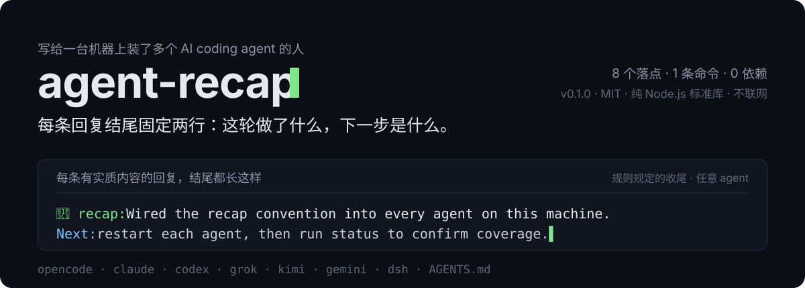
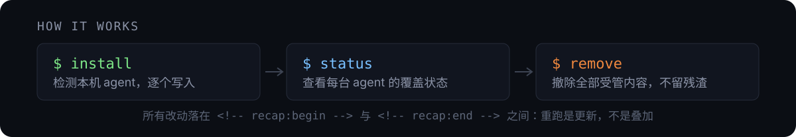
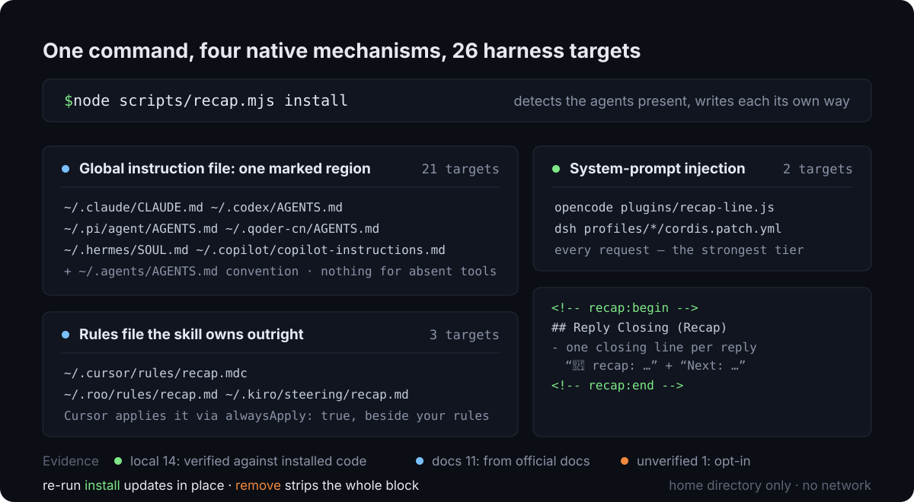

# agent-recap

<p align="center">
  
</p>

<p align="center">
  <b>中文</b> · <a href="#english">English</a>
</p>

## 有什么用

给这台机器上所有 AI coding agent 装上同一条收尾规则：每条有实质内容的回复结尾，附一行 `🏁 **recap:**` 说明这轮在做什么、为什么，再加一行 `➡️ **Next:**` 说明当前状态、阻塞或下一步；收尾区块上方默认有一条 `---` 分隔线。

不装这个 Skill 时：每个 agent 的回复风格各不相同，长篇回复看完不知道干了什么、下一步该干什么；想统一就得逐台查它的全局指令文件写在哪、格式是否兼容，漏一个就是一个例外。装好之后：一条命令检测本机装了哪些 agent，按各自的原生机制写入，重复执行是原地更新不会叠加，一条命令全体撤除。

## 怎么工作

<p align="center">
  
</p>

### 落点路径已核实的 harness（`local` 证据档）

| Agent | 落点 | 原生机制 | 证据 |
|---|---|---|---|
| OpenCode | `~/.config/opencode/plugins/recap-line.js` | 插件钩子，每次请求把规则追加进系统提示 | local |
| Claude Code | `~/.claude/CLAUDE.md` | 全局用户指令 | local |
| Codex | `~/.codex/AGENTS.md` | 全局规则文件 | local |
| Grok | `~/.grok/AGENTS.md` | 全局规则文件 | local |
| Kimi Code | `~/.kimi-code/AGENTS.md` | 启动时收集的全局指令 | local |
| Gemini CLI | `~/.gemini/GEMINI.md` | 全局上下文文件 | docs |
| dsh | `~/.dsh/profiles/*/cordis.patch.yml` | `system-prompt` 插件的 `personaSuffix`，每个 profile 一条 | local |
| pi | `~/.pi/agent/AGENTS.md` | 全局指令文件 | local，headless 实测已生效 |
| Command Code | `~/.commandcode/AGENTS.md` | 全局 user memory | local，headless 实测已生效 |
| Qoder CLI | `~/.qoder/AGENTS.md` 或 `~/.qoder-cn/AGENTS.md` | 全局 memory 文件 | local，headless 实测已生效 |
| WorkBuddy | `~/.workbuddy/SOUL.md` | 全局人设文件，首轮作为 `SoulContent` 注入 | local，安装包与运行日志核实 |
| Cline | `~/Documents/Cline/Rules/recap.md` | 全局 rules 目录，本 Skill 自持一个文件 | local，安装包二进制核实 |
| ZCode | `~/.zcode/AGENTS.md` | 用户级指令文件，会先于工作区 AGENTS.md 合并 | local，安装包与本地配置核实 |
| Cursor CLI | `~/.cursor/rules/recap.mdc` | scope 为 user 的 `.mdc` 规则，`alwaysApply: true`；**`~/.cursor/AGENTS.md` 不会被读取** | local |
| Antigravity | `~/.gemini/config/AGENTS.md` | 全局 customization root 下的规则文件 | local |
| Hermes | `~/.hermes/SOUL.md` | 身份文件，系统提示的第一槽位 | local |
| misaka | `~/.misaka/MISAKA.md` | 共享身份文件，先于各角色加载 | local |
| 约定兜底 | `~/.agents/AGENTS.md` | 跨 agent 的 AGENTS.md 约定 | local |

### 按官方文档适配的主流 harness（工具未安装时，`install` 不会写入任何文件）

| Agent | 落点 |
|---|---|
| GitHub Copilot CLI | `~/.copilot/copilot-instructions.md` |
| Qwen Code | `~/.qwen/QWEN.md` |
| Crush | `~/.config/crush/CRUSH.md` + `~/.config/AGENTS.md` |
| Amp | `~/.config/amp/AGENTS.md` + `~/.config/AGENTS.md` |
| Zed Agent | `~/.config/zed/AGENTS.md` |
| Devin CLI | `~/.config/devin/AGENTS.md` |
| Goose | `~/.config/goose/.goosehints` |
| Windsurf Cascade | `~/.codeium/windsurf/memories/global_rules.md`（该文件有 6000 字符上限） |
| Roo Code | `~/.roo/rules/recap.md`（本 Skill 自持一个文件，不动你写的规则） |
| Kiro CLI | `~/.kiro/steering/recap.md` |
| Trae | `~/.trae-cn/user_rules/recap.md`（IDE）和 `~/.trae-cn/rules/recap.md`（CLI）；国际版对应 `~/.trae`，两个目录都存在时都写 |
| Kilo Code | `~/.kilocode/rules/recap.md`；旧的 `~/.config/kilo/kilo.jsonc` instructions 配置项不是可维护的规则文件 |
| Continue | `~/.continue/rules/recap.md`；旧版 VS Code 扩展有忽略规则的已知问题，按建议级处理 |

覆盖强度分三档：OpenCode 插件和 dsh 的 patch 每次请求注入系统提示；其余是 agent 启动时加载的指令文件，属于建议级；`~/.agents/AGENTS.md` 只覆盖会读这个约定的工具。证据分档（`local` = 从该工具已安装的代码里核实出来的路径，`docs` = 官方文档，`unverified` = 需 `--experimental` 才写）、每个适配器的取证依据和漂移风险见 `references/adapters.md`。iFlow 已停服、Amazon Q CLI 已改名 Kiro，这些**故意不收录**；Trae 的 IDE 与 CLI 文档对全局规则目录写法不同，本 Skill 会写入所有已存在的目录。WorkBuddy 的 UI 全局规则存在它自己的数据存储里，`SOUL.md` 是稳定的明文落点。

## 安装

1. 把仓库地址告诉 Agent："请帮我安装这个 Skill。"

   ```
   https://github.com/Haoo-7/agent-recap
   ```

2. 或直接用命令安装：

   ```bash
   npx skills add Haoo-7/agent-recap
   ```

两种方式都需要 `npx`（仅安装时需要）。Skill 本身运行只依赖 Node.js，不联网、无第三方包。

## 配置

首次使用无需任何配置。默认 `---` 分隔线 + `🏁 **recap:**` 和 `➡️ **Next:**` 两行标签（均加粗）、两句话上限。想改格式：编辑 `scripts/recap.mjs` 顶部的 `CONFIG`（`prefix`、`nextLabel`、`separator`、`maxSentences`），重跑一次 install，所有 agent 原地更新；把 `separator` 设为空字符串即可去掉分隔线。

## 使用

用自然语言触发，例如：

- "以后我每个 agent 回复结尾都带 recap 小结"
- "recap 前缀换成 🎯，允许三句话"
- "把 recap 全撤掉"

常用命令（在 Skill 目录内执行）：

```bash
node scripts/recap.mjs install              # 检测已装 agent 并逐个写入
node scripts/recap.mjs status               # 查看每个 agent 的覆盖状态和证据档
node scripts/recap.mjs remove               # 撤除全部受管内容
node scripts/recap.mjs install --skip=hermes,misaka   # 不想写进身份文件就跳过
node scripts/recap.mjs install --experimental        # 连未验证的适配器一起写
```

所有子命令支持 `--dry-run`，只打印计划不写文件。改动对所有 agent 生效需要各自重启。

## 兼容性与依赖

- Node.js 任意较新版本，只用标准库。
- macOS 已实测；Windows / Linux 未实测（脚本不依赖任何平台命令，预期可用）。
- 每个适配器的证据档（`local` / `docs` / `unverified`）、适配的 agent 版本和漂移风险见
  `references/adapters.md`；`unverified` 默认不写，需要 `--experimental`。

## 数据与适用边界

- 只在本机用户目录内写文件，不读取对话内容，不接触任何密钥，不联网。
- 只会替换 `<!-- recap:begin -->` / `<!-- recap:end -->` 之间的内容；同名外部文件先备份再替换，不删除用户内容。
- 没装过指令文件的 agent 会新建对应文件；OpenCode 得到插件文件，Cursor 得到 `recap.mdc`，Roo / Kiro 得到各自 rules 目录里的受管文件。`remove` 只删这些受管内容，Hermes 和 misaka 的身份文件永远不会被整体删除。
- 只检测到二进制、但还没有配置目录的 harness 不会被写入任何东西（`status` 报 `no landing dir`），避免凭一个同名程序替别人建配置树。
- 不适用：对当前对话做一次性总结、修改其他回复行为、手工修改单个 agent 的配置。

## 测试

```bash
node --test tests/recap.test.mjs    # 生命周期回归：安装、幂等、改配置、卸载
node scripts/recap.mjs status       # 查看本机覆盖情况
```

---

## English

<p align="center">
  
</p>

> Chinese is the primary language of this document; the sections above are the reference version.

### What it does

For people who run several AI coding agents on one machine: every substantive reply ends with
two fixed lines — a `🏁 **recap:**` line saying what the turn did and why, and a `➡️ **Next:**` line with
the current state, blocker, or next step. Both labels are bold, and a `---` divider sits above the block.

Without it, each agent has its own reply style, long answers leave you guessing what happened
and what comes next, and unifying them means finding each agent's global instruction file and
checking whether the format is even supported. With it, one command detects which agents are
installed, writes through each agent's native mechanism, updates in place on re-run instead of
appending duplicates, and one command removes everything.

### How it works

<p align="center">
  
</p>

### Adapters whose paths were verified against installed code (`local` tier)

| Agent | Target | Native mechanism | Evidence |
|---|---|---|---|
| OpenCode | `~/.config/opencode/plugins/recap-line.js` | Plugin hook that appends the rules to the system prompt on every request | local |
| Claude Code | `~/.claude/CLAUDE.md` | Global user instructions | local |
| Codex | `~/.codex/AGENTS.md` | Global rules file | local |
| Grok | `~/.grok/AGENTS.md` | Global rules file | local |
| Kimi Code | `~/.kimi-code/AGENTS.md` | Global instructions collected at startup | local |
| Gemini CLI | `~/.gemini/GEMINI.md` | Global context file | docs |
| dsh | `~/.dsh/profiles/*/cordis.patch.yml` | `personaSuffix` of the `system-prompt` plugin, one entry per profile | local |
| pi | `~/.pi/agent/AGENTS.md` | Global instructions file | local, confirmed headless |
| Command Code | `~/.commandcode/AGENTS.md` | Global user memory | local, confirmed headless |
| Qoder CLI | `~/.qoder/AGENTS.md` or `~/.qoder-cn/AGENTS.md` | Global memory file | local, confirmed headless |
| WorkBuddy | `~/.workbuddy/SOUL.md` | Global persona file, injected as `SoulContent` on the first turn | local, verified from the bundle and runtime logs |
| Cline | `~/Documents/Cline/Rules/recap.md` | Global rules directory; this skill owns one file there | local, verified from the installed binary |
| ZCode | `~/.zcode/AGENTS.md` | User-level instruction file, merged before the workspace AGENTS.md | local, verified from the bundle and local config |
| Cursor CLI | `~/.cursor/rules/recap.mdc` | Scope-`user` `.mdc` rule with `alwaysApply: true`; **`~/.cursor/AGENTS.md` is not read** | local |
| Antigravity | `~/.gemini/config/AGENTS.md` | Rule file in the global customization root | local |
| Hermes | `~/.hermes/SOUL.md` | Identity file, system-prompt slot #1 | local |
| misaka | `~/.misaka/MISAKA.md` | Shared identity file, loaded before every role | local |
| AGENTS.md fallback | `~/.agents/AGENTS.md` | Cross-agent AGENTS.md convention | local |

### Mainstream harnesses (documented adapters; they write nothing until you install one)

| Agent | Target |
|---|---|
| GitHub Copilot CLI | `~/.copilot/copilot-instructions.md` |
| Qwen Code | `~/.qwen/QWEN.md` |
| Crush | `~/.config/crush/CRUSH.md` + `~/.config/AGENTS.md` |
| Amp | `~/.config/amp/AGENTS.md` + `~/.config/AGENTS.md` |
| Zed Agent | `~/.config/zed/AGENTS.md` |
| Devin CLI | `~/.config/devin/AGENTS.md` |
| Goose | `~/.config/goose/.goosehints` |
| Windsurf Cascade | `~/.codeium/windsurf/memories/global_rules.md` (that file is capped at 6,000 characters) |
| Roo Code | `~/.roo/rules/recap.md` (this skill owns the file, never your rules) |
| Kiro CLI | `~/.kiro/steering/recap.md` |
| Trae | `~/.trae-cn/user_rules/recap.md` (IDE) and `~/.trae-cn/rules/recap.md` (CLI); international builds use `~/.trae` — every existing dir is written |
| Kilo Code | `~/.kilocode/rules/recap.md`; the legacy `instructions` key in `~/.config/kilo/kilo.jsonc` is a config key, not a maintainable rules file |
| Continue | `~/.continue/rules/recap.md`; older VS Code builds ignored rules, so this is advisory |

Coverage comes in three strengths: the OpenCode plugin and the dsh patch inject the rules into
the system prompt on every request; everything else is an instruction file loaded at agent
startup, so it is advisory; `~/.agents/AGENTS.md` only reaches tools that read that convention.
Evidence tiers — `local` (path read out of that tool's installed code), `docs` (official
documentation) and `unverified` (written only with `--experimental`) — plus the basis for every
adapter and its drift risks are in `references/adapters.md`. iFlow is shut down and the Amazon Q
CLI became Kiro: those are deliberately **not** included.
Trae's IDE and CLI docs name different global rules dirs, so this skill writes every one that
already exists. WorkBuddy's UI global rules live in its own data store; `SOUL.md` is the stable
plain-file slot.

### Install

```bash
npx skills add Haoo-7/agent-recap
```

Or just hand the repository URL to your agent and ask it to install the Skill:
`https://github.com/Haoo-7/agent-recap`

`npx` is needed for installation only. The Skill itself runs on Node.js — no network, no
third-party packages.

### Configuration

Nothing to configure on first use. Default `---` divider plus labels `🏁 **recap:**` and
`➡️ **Next:**`, both bold, a two-sentence cap. To change the format: edit `CONFIG` at the top of
`scripts/recap.mjs` (`prefix`, `nextLabel`, `separator`, `maxSentences`) and re-run install —
every agent updates in place. Set `separator` to `''` to drop the divider.

### Usage

Trigger it in natural language, for example:

- "From now on every agent reply ends with a recap line"
- "Change the prefix to 🎯 and allow three sentences"
- "Remove all recap lines"

Common commands (run inside the Skill directory):

```bash
node scripts/recap.mjs install                       # detect installed agents and write each one
node scripts/recap.mjs status                        # per-agent coverage and evidence tier
node scripts/recap.mjs remove                        # strip everything this skill manages
node scripts/recap.mjs install --skip=hermes,misaka  # keep task rules out of persona files
node scripts/recap.mjs install --experimental        # include unverified adapters
```

Every subcommand accepts `--dry-run`, which prints the plan without writing. Each agent needs
a restart before the change takes effect.

### Compatibility and dependencies

- Any recent Node.js; standard library only.
- Tested on macOS; Windows / Linux untested (the script uses no platform-specific commands and
  is expected to work).
- Evidence tier (`local` / `docs` / `unverified`), target agent version, and drift risk per
  adapter in `references/adapters.md`; `unverified` adapters are written only with
  `--experimental`.

### Data and limits

- Writes only inside the user's home directory. Never reads conversation content, never touches
  credentials, never makes network calls.
- Only replaces what is between `<!-- recap:begin -->` and `<!-- recap:end -->`. A foreign file
  sharing a managed path is backed up first, never deleted.
- An agent with no instruction file gets one created; OpenCode gets the plugin file, Cursor gets
  `recap.mdc`, Roo and Kiro get one managed file in their rules directory. `remove` deletes only
  this managed content, and a Hermes or misaka persona file is never deleted wholesale.
- A harness detected only through a stray binary, with no config dir yet, gets nothing written —
  `status` reports `no landing dir` instead of creating someone else's config tree.
- Out of scope: one-off summaries of the current conversation, changing any other reply
  behavior, hand-editing one agent's configuration.

### Tests

```bash
node --test tests/recap.test.mjs    # lifecycle: install, idempotency, config change, removal
node scripts/recap.mjs status       # local coverage
```
