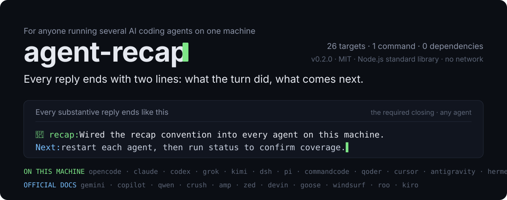

# agent-recap

<p align="center">
  
</p>

<p align="center">
  <b>中文</b> · <a href="#english">English</a>
</p>

## 有什么用

给这台机器上所有 AI coding agent 装上同一条收尾规则：每条有实质内容的回复结尾，附一行 `🏁 recap:` 说明这轮在做什么、为什么，再加一行 `Next:` 说明当前状态、阻塞或下一步。

不装这个 Skill 时：每个 agent 的回复风格各不相同，长篇回复看完不知道干了什么、下一步该干什么；想统一就得逐台查它的全局指令文件写在哪、格式是否兼容，漏一个就是一个例外。装好之后：一条命令检测本机装了哪些 agent，按各自的原生机制写入，重复执行是原地更新不会叠加，一条命令全体撤除。

## 怎么工作

<p align="center">
  
</p>

| Agent | 落点 | 原生机制 |
|---|---|---|
| OpenCode | `~/.config/opencode/plugins/recap-line.js` | 插件钩子，每次请求把规则追加进系统提示 |
| Claude Code | `~/.claude/CLAUDE.md` | 全局用户指令 |
| Codex | `~/.codex/AGENTS.md` | 全局规则文件 |
| Grok | `~/.grok/AGENTS.md` | 全局规则文件 |
| Kimi Code | `~/.kimi-code/AGENTS.md` | 启动时收集的全局指令 |
| Gemini CLI | `~/.gemini/GEMINI.md` | 全局上下文文件（按约定推断，未在真实安装上验证） |
| dsh | `~/.dsh/profiles/*/cordis.patch.yml` | `system-prompt` 插件的 `personaSuffix`，每个 profile 一条 |
| 约定兜底 | `~/.agents/AGENTS.md` | 跨 agent 的 AGENTS.md 约定 |

覆盖强度分三档：OpenCode 插件和 dsh 的 patch 每次请求注入系统提示；其余五个是 agent 启动时加载的指令文件，属于建议级；`~/.agents/AGENTS.md` 只覆盖会读这个约定的工具。每个适配器的验证版本和漂移风险见 `references/adapters.md`。

## 安装

1. 把仓库地址告诉 Agent："请帮我安装这个 Skill。"

   ```
   https://github.com/Haoo-7/agent-recap
   ```

2. 或直接用命令安装：

   ```bash
   npx skills add Haoo-7/agent-recap
   ```

两种方式都需要 `npx`（仅安装时需要）。Skill 本身运行只依赖 Node.js，不联网、无第三方包。

## 配置

首次使用无需任何配置。默认 `🏁 recap:` 前缀、两句话上限。想改格式：编辑 `scripts/recap.mjs` 顶部的 `CONFIG`（`prefix`、`nextLabel`、`maxSentences`），重跑一次 install，所有 agent 原地更新。

## 使用

用自然语言触发，例如：

- "以后我每个 agent 回复结尾都带 recap 小结"
- "recap 前缀换成 🎯，允许三句话"
- "把 recap 全撤掉"

常用命令（在 Skill 目录内执行）：

```bash
node scripts/recap.mjs install    # 检测已装 agent 并逐个写入
node scripts/recap.mjs status     # 查看每个 agent 的覆盖状态
node scripts/recap.mjs remove     # 撤除全部受管内容
```

所有子命令支持 `--dry-run`，只打印计划不写文件。改动对所有 agent 生效需要各自重启。

## 兼容性与依赖

- Node.js 任意较新版本，只用标准库。
- macOS 已实测；Windows / Linux 未实测（脚本不依赖任何平台命令，预期可用）。
- 每个适配器的验证状态、适配的 agent 版本和漂移风险见 `references/adapters.md`；未验证的适配器按尽力而为处理。

## 数据与适用边界

- 只在本机用户目录内写文件，不读取对话内容，不接触任何密钥，不联网。
- 只会替换 `<!-- recap:begin -->` / `<!-- recap:end -->` 之间的内容；同名外部文件先备份再替换，不删除用户内容。
- 没装过指令文件的 agent 会新建对应文件，OpenCode 额外得到一个插件文件；`remove` 只删这些受管内容。
- 不适用：对当前对话做一次性总结、修改其他回复行为、手工修改单个 agent 的配置。

## 测试

```bash
node --test tests/recap.test.mjs    # 生命周期回归：安装、幂等、改配置、卸载
node scripts/recap.mjs status       # 查看本机覆盖情况
```

---

## English

<p align="center">
  
</p>

> Chinese is the primary language of this document; the sections above are the reference version.

### What it does

For people who run several AI coding agents on one machine: every substantive reply ends with
two fixed lines — a `🏁 recap:` line saying what the turn did and why, and a `Next:` line with
the current state, blocker, or next step.

Without it, each agent has its own reply style, long answers leave you guessing what happened
and what comes next, and unifying them means finding each agent's global instruction file and
checking whether the format is even supported. With it, one command detects which agents are
installed, writes through each agent's native mechanism, updates in place on re-run instead of
appending duplicates, and one command removes everything.

### How it works

<p align="center">
  
</p>

| Agent | Target | Native mechanism |
|---|---|---|
| OpenCode | `~/.config/opencode/plugins/recap-line.js` | Plugin hook that appends the rules to the system prompt on every request |
| Claude Code | `~/.claude/CLAUDE.md` | Global user instructions |
| Codex | `~/.codex/AGENTS.md` | Global rules file |
| Grok | `~/.grok/AGENTS.md` | Global rules file |
| Kimi Code | `~/.kimi-code/AGENTS.md` | Global instructions collected at startup |
| Gemini CLI | `~/.gemini/GEMINI.md` | Global context file (inferred from convention, not verified on a real install) |
| dsh | `~/.dsh/profiles/*/cordis.patch.yml` | `personaSuffix` of the `system-prompt` plugin, one entry per profile |
| AGENTS.md fallback | `~/.agents/AGENTS.md` | Cross-agent AGENTS.md convention |

Coverage comes in three strengths: the OpenCode plugin and the dsh patch inject the rules into
the system prompt on every request; the other five are instruction files loaded at agent
startup, so they are advisory; `~/.agents/AGENTS.md` only reaches tools that read that
convention. Per-adapter verification and drift risk: `references/adapters.md`.

### Install

```bash
npx skills add Haoo-7/agent-recap
```

Or just hand the repository URL to your agent and ask it to install the Skill:
`https://github.com/Haoo-7/agent-recap`

`npx` is needed for installation only. The Skill itself runs on Node.js — no network, no
third-party packages.

### Configuration

Nothing to configure on first use. Default prefix `🏁 recap:`, two-sentence cap. To change the
format: edit `CONFIG` at the top of `scripts/recap.mjs` (`prefix`, `nextLabel`,
`maxSentences`) and re-run install — every agent updates in place.

### Usage

Trigger it in natural language, for example:

- "From now on every agent reply ends with a recap line"
- "Change the prefix to 🎯 and allow three sentences"
- "Remove all recap lines"

Common commands (run inside the Skill directory):

```bash
node scripts/recap.mjs install    # detect installed agents and write each one
node scripts/recap.mjs status     # per-agent coverage
node scripts/recap.mjs remove     # strip everything this skill manages
```

Every subcommand accepts `--dry-run`, which prints the plan without writing. Each agent needs
a restart before the change takes effect.

### Compatibility and dependencies

- Any recent Node.js; standard library only.
- Tested on macOS; Windows / Linux untested (the script uses no platform-specific commands and
  is expected to work).
- Verification status, target agent version, and drift risk per adapter in
  `references/adapters.md`; unverified adapters are best effort.

### Data and limits

- Writes only inside the user's home directory. Never reads conversation content, never touches
  credentials, never makes network calls.
- Only replaces what is between `<!-- recap:begin -->` and `<!-- recap:end -->`. A foreign file
  sharing a managed path is backed up first, never deleted.
- An agent with no instruction file gets one created; OpenCode additionally gets the plugin
  file. `remove` deletes only this managed content.
- Out of scope: one-off summaries of the current conversation, changing any other reply
  behavior, hand-editing one agent's configuration.

### Tests

```bash
node --test tests/recap.test.mjs    # lifecycle: install, idempotency, config change, removal
node scripts/recap.mjs status       # local coverage
```
